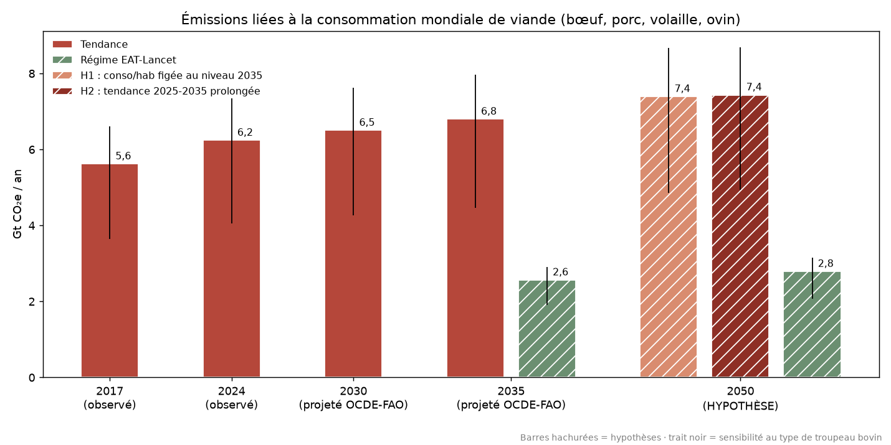

# 🥩 Empreinte environnementale de la consommation de viande

Projet de data science qui croise la **consommation de viande par pays** avec
l'**impact environnemental par kg** de chaque viande (gaz à effet de serre, eau,
surface, eutrophisation), puis **prédit** son évolution jusqu'en 2030 et analyse les
conséquences à l'horizon 2050.



## Résultats clés (Monde)

| | 2017 | 2024 | 2030 | 2035 | 2050 |
|---|---|---|---|---|---|
| Statut | observé | observé | projeté OCDE-FAO | projeté OCDE-FAO | hypothèse |
| Population (ONU) | 7,65 Md | 8,16 Md | 8,57 Md | 8,89 Md | 9,66 Md |
| Consommation (kg/hab/an) | 27,5 | 28,8 | 29,2 | 29,5 | 29,5 – 30,2 |
| Émissions (Gt CO₂e/an)\* | 5,6 | 6,2 | 6,5 | 6,8 | 7,4 |
| Surface utilisée\* | 1,65 Gha | 1,84 Gha | 1,92 Gha | 2,02 Gha | 2,2 Gha |

\* Calcul : consommation OCDE-FAO × coefficients Poore & Nemecek × population ONU.
Hypothèse centrale : 2/3 du bœuf issu de troupeaux allaitants (fourchette 2024 selon
cette hypothèse : 4,1 – 7,3 Gt).

- **La consommation par habitant se stabilise**, mais l'impact total augmente : entre
  2024 et 2035, la quasi-totalité de la hausse (+0,55 Gt sur +0,56 Gt) s'explique par
  la croissance de la population.
- **Les émissions liées à la viande vont à contre-courant des objectifs climatiques** :
  +4 % entre 2024 et 2030 selon les projections, alors que la trajectoire 1,5 °C exige
  −42 % d'émissions mondiales entre 2019 et 2030 (UNEP, *Emissions Gap Report 2024*).
- **En 2050**, même à consommation par habitant constante, il faudrait ≈ 360 Mha de
  surface en plus par rapport à 2024 (≈ 6,6 fois la France métropolitaine).
- **Un régime de type EAT-Lancet** (14 g/j de viande rouge, 29 g/j de volaille)
  réduirait les émissions d'environ 62 % en 2050 par rapport à la tendance ; l'effort
  porte sur la viande rouge, la volaille restant proche du niveau mondial actuel.
- **Le passage du bœuf vers la volaille** a freiné l'impact (effet « mix » négatif au
  niveau mondial entre 2000 et 2017), mais ne suffit pas à le faire baisser.

## Application Streamlit

Une application interactive permet d'explorer les résultats :

- **🌍 Empreinte par pays** : carte, classement, évolution par zone et par viande,
  équivalents concrets (km en voiture, douches, courts de tennis).
- **🔀 Effet de substitution** : impact réel vs impact si la répartition entre viandes
  était restée figée, et décomposition LMDI (population / quantité / mix).
- **🔮 Prédiction 2030** : prévisions avec intervalle à 80 %, comparaison aux
  projections OCDE, scénario de substitution réglable, résultats du backtest.
- **📖 Méthode & sources**.

Choix de l'indicateur et de l'hypothèse sur le bœuf dans la barre latérale. Chaque
indicateur est expliqué dans l'application : ce qu'il mesure, ce qui est compté,
pourquoi il compte, unités, et comparaison de l'impact d'1 kg de chaque viande.

## Installation

```bash
python -m venv .venv
# Windows
.venv\Scripts\activate
# macOS / Linux
source .venv/bin/activate

pip install -r requirements.txt
```

## Utilisation

```bash
streamlit run app.py                         # lancer l'application
python forecast.py                           # backtest + prévisions -> data/processed/forecast*.csv
python notebooks/01_exploration.py           # exploration + figures 01 à 04
python notebooks/02_analyse_2030_2050.py     # analyse 2024 / 2030 / 2035 / 2050 + figure 05
```

## Structure

```
app.py                         Application Streamlit
impact.py                      Calcul de l'empreinte et décomposition (LMDI, contrefactuel)
forecast.py                    Modèles de prévision et backtest
notebooks/
  01_exploration.py            Exploration et nettoyage du dataset OCDE (1990-2026)
  02_analyse_2030_2050.py      Analyse des conséquences sur données OCDE-FAO 2026-2035
data/raw/                      Données sources téléchargées
data/processed/                Données nettoyées, prévisions, résultats d'analyse
figures/                       Graphiques générés
```

## Méthode

**Empreinte** = kg consommés par habitant × coefficient d'impact par kg (pour chaque
viande), × population pour un total.

**Prévision** (`forecast.py`) : 180 séries zone × viande (1990-2017), modélisées en
`log(1 + kg)`. Cinq modèles comparés par backtest à origines glissantes (2005, 2007,
2009, 2011 ; horizon 6 ans) :

| Modèle | Erreur (WAPE) |
|---|---|
| Gradient boosting global (retenu) | 10,0 % |
| Ensemble | 11,0 % |
| Naïf (dernière valeur) | 11,2 % |
| Holt amorti | 11,8 % |
| Tendance linéaire | 15,1 % |

Les intervalles de prévision à 80 % sont calibrés sur les erreurs du backtest.

**Vérification sur données réelles** : confrontée aux données OCDE-FAO publiées
ensuite, la prévision de l'évolution mondiale 2017 → 2023 est de +3,9 % pour un réel
de +3,6 % (la projection OCDE de 2018 donnait +0,5 %). Au niveau des pays, les erreurs
restent importantes pour toutes les méthodes.

## Données et sources

| Donnée | Source |
|---|---|
| Consommation 1990-2026 (app, prévision) | OCDE-FAO, *Meat consumption* (version 2018), via [OpenML #43758](https://www.openml.org/d/43758) |
| Consommation 1990-2035 (analyse) | [OCDE-FAO Agricultural Outlook 2026-2035](https://www.oecd.org/en/publications/oecd-fao-agricultural-outlook-2026-2035_47874669-en/full-report/meat_149b4ca3.html), API SDMX de l'OCDE |
| Impact par kg | Poore & Nemecek (2018), *Science* 360(6392), via [Our World in Data](https://ourworldindata.org/food-ghg-emissions) |
| Population | ONU, *World Population Prospects 2024*, via [Our World in Data](https://ourworldindata.org/grapher/population-with-un-projections) |
| Repères climat | [UNEP, Emissions Gap Report 2024](https://www.unep.org/interactives/emissions-gap-report/2024/) ; [FAO (2023), Pathways towards lower emissions](https://www.fao.org/newsroom/detail/new-fao-report-maps-pathways-towards-lower-livestock-emissions/en) |

Les données restent soumises aux conditions d'utilisation de leurs producteurs respectifs.

## Limites

- Coefficients d'impact **mondiaux et figés (2010)** : ni les différences de pratiques
  d'élevage entre pays, ni les gains de productivité ne sont pris en compte.
- La répartition du bœuf entre troupeaux allaitants et laitiers n'est pas connue :
  c'est l'hypothèse qui pèse le plus sur les émissions.
- Le dataset OCDE de 2018 (application) et l'Outlook 2026-2035 (analyse) ne mesurent
  pas la consommation de la même façon (34,4 vs 27,5 kg/hab pour le Monde en 2017) :
  leurs niveaux ne sont pas comparables entre eux.
- Couverture : bœuf, porc, volaille, ovin uniquement (pas de poisson) ; ~40 pays
  détaillés, la France est incluse dans l'Union européenne.
- 2050 est une **hypothèse** (aucune projection officielle de la consommation par
  habitant à cet horizon).
- Les comparaisons aux émissions mondiales sont des ordres de grandeur : approche
  consommation (analyse de cycle de vie) vs inventaires territoriaux.
